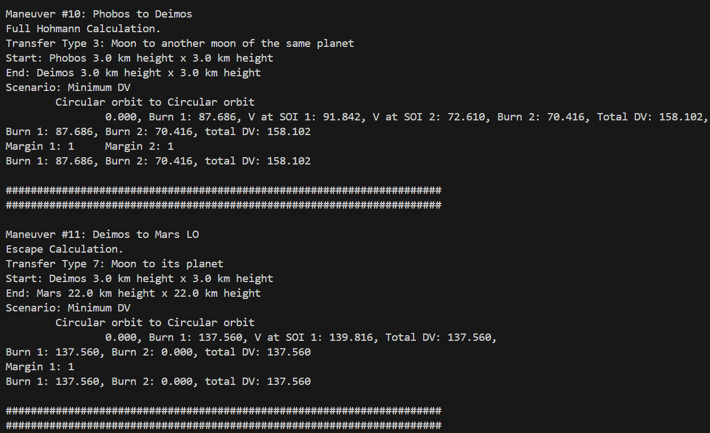
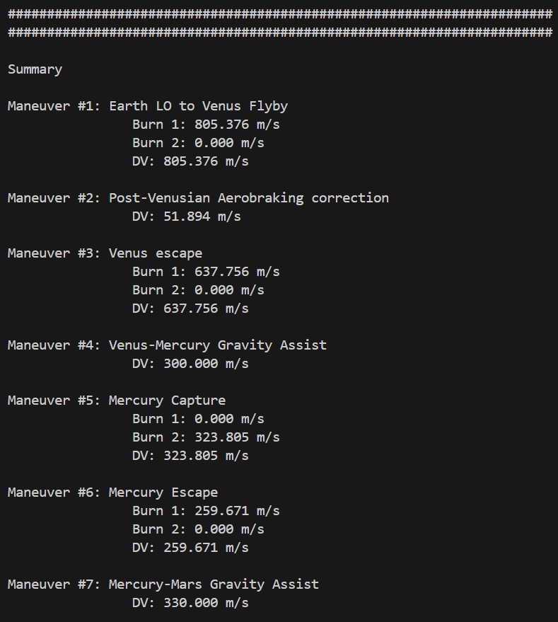

SFS Maneuver Calculator

A Python script to calculate the ΔV of a set of maneuvers. There are two setups to configure: file paths and maneuver list file.

1.  Main Script
    The main script needs three inputs, planet_pack_path, maneuver_path, and plot_maneuver.
If .env is not used, insert them as  planet_pack_path and maneuver_path, respectively. The lines for dotenv setup can be removed.
If .env is used, configure the path for each on the .env file.
Set plot_maneuver to True if one wants to see the plot of the trajectory.

2. Maneuver list file
    There are there examples of maneuver list file. The file uses .json formatting. "maneuverdefault" is the format for each type of maneuvers. There are 5 types, each with a list of required parameters.

    1. Type 0
        This is just an addition of ΔV to the calculation. For example, gravity assist correction burns, RCS offset, extra margin, landing maneuver, etc.
        Required parameters:
        1.  type    : 0
        2.  DV      : the amount of ΔV
        3.  margin  : the margin of ΔV. Starting with "+" will adds the value to ΔV, while plain numbers will be multiplied to ΔV

            For example, for ΔV = "100", Margin = "+10" will result in 110 m/s, while Margin = "1.04" will result in 104 m/s.
    2. Type 1
        This maneuver is an apsis change maneuver. For example, from low orbit to high elliptic orbit.
        Required parameters:
        1.  type    : 1
        2.  b       : The celestial body the spacecraft is orbiting
        3.  A1      : The apsis where the burn is performed
        4.  A21     : Initial opposite apsis
        5.  A22     : Final opposite apsis
        6.  margin

            For apsides, the format is either "LO", "####", "###h". Numbers must be in meters.
            LO is low orbit, set at 2km above minimum timewarp speed height
            "####" is distance from the center of the celestial body
            "####h" is the height from the surface of the celestial body.
    3. Type 2
        This maneuver only calculates ΔV of an escape maneuver. Typically for planning a flyby.
    4. Type 3
        This maneuver only calculates ΔV of a capture maneuver. Typically for calculating capture maneuver from an arbitrary orbit.
    5. Type 4
        A fully Hohmann transfer maneuver. Calculates both the escape and capture ΔV

        For maneuver type 2,3,4, the required parameters are:
        1.  type    : 2/3/4
        2.  b1      : Inital celestial body
        3.  A1      : Apoapsis at b1
        4.  P1      : Periapsis at b1
        5.  argP1   : argument of periapsis, in degrees
        6.  margin1 : margin for the first maneuver
        7.  b2      : Final celestial body
        8.  A2      : Apoapsis at b2
        9.  P2      : Periapsis at b2
        10. argP2   : argument of periapsis at b2
        11. margin2 : margin for the second maneuver
        12. scenario: the value is "max" or "min", depending on one's needs

        Eventhough maneuver 2 and 3 seems to have redundant requirements, for example a flyby from Low Earth Orbit to Venus doesn't require the apsides at Venus to be defined, it would need to be defined if the flyby is, for example, from Low Moon Orbit to Low Earth Orbit.

After both is set up, hit run and the script will print out the calculating process, and finally will print out the summary of the ΔV for each maneuver and the total ΔV.

There are some limitations:
1.  Limited to up to 3 level planet systems: central body (level 1), orbiting central body (level 2), orbiting level 2 (level 3).
2.  Assumes perfect alignment.
3.  The script does not compute when to do the maneuver.
4.  As for now, in the case of calculation from a higher level body to a lower level, for example from Sun orbit to Mercury capture, if the Sun orbit and Mercury orbit crosses, there are possibility where the calculation could go wrong.

Example process print out:

Example summary print out:

